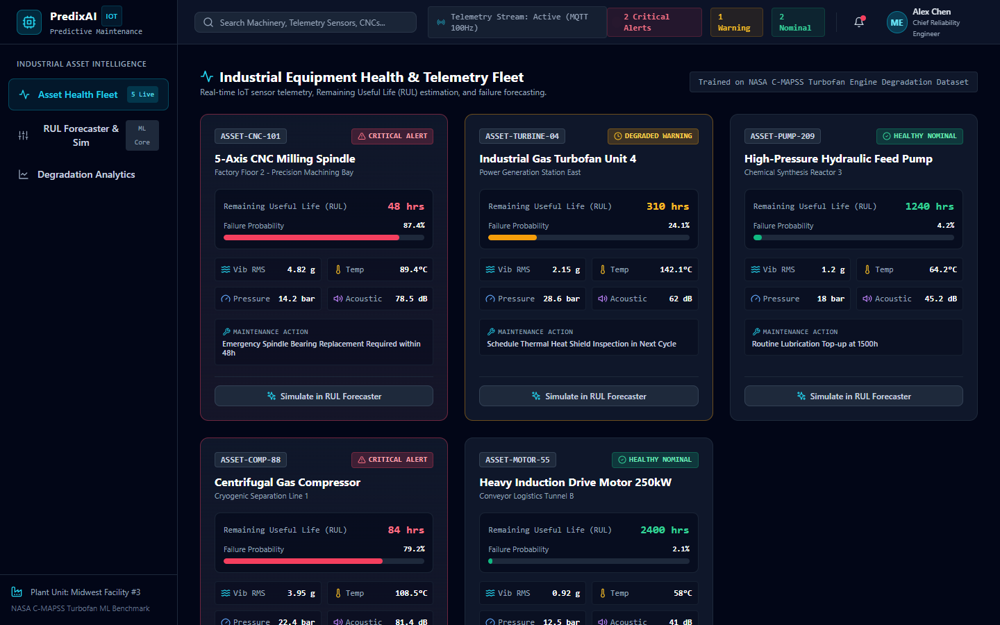
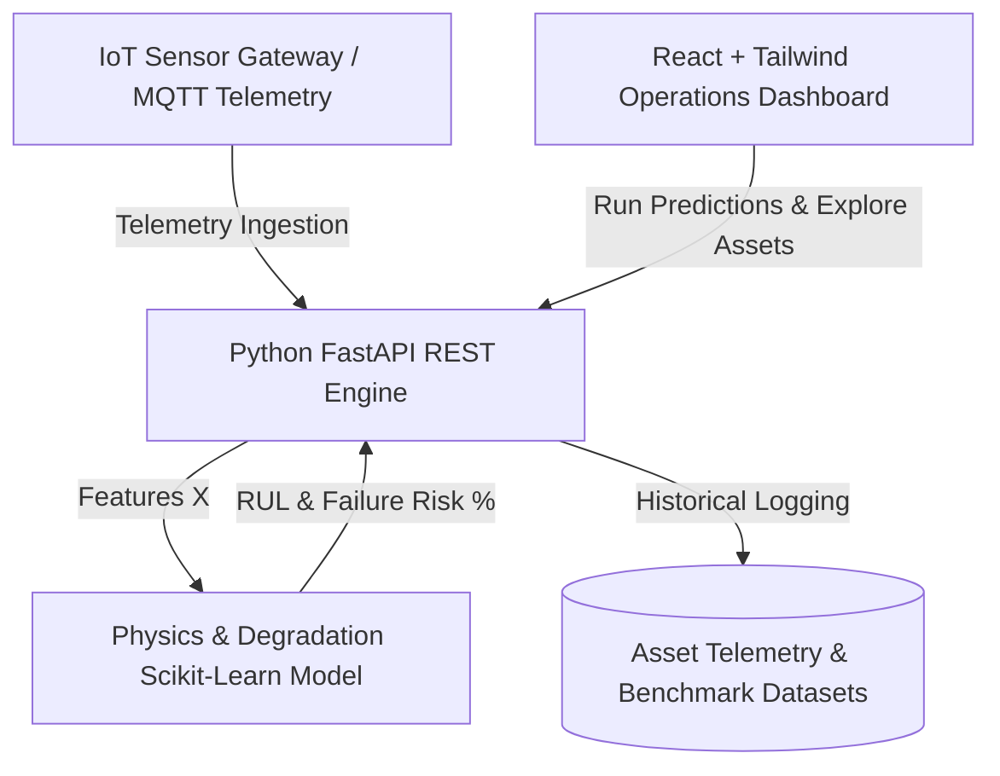

# Predictive Maintenance AI — Industrial Asset Health & RUL Forecaster

[](LICENSE)
[](https://www.python.org/)
[](https://fastapi.tiangolo.com/)
[](https://react.dev/)
[](https://tailwindcss.com/)
[](data/kaggle_predictive_maintenance_sensor_benchmark.csv)
[](https://www.docker.com/)

Predictive Maintenance AI is an industrial IoT analytics platform designed for factory automation, turbomachinery, CNC spindles, and high-pressure hydraulic pumps. By analyzing high-frequency multi-variate sensor degradation telemetry, it estimates asset Remaining Useful Life (RUL), forecasts failure probabilities, and delivers explainable maintenance actions before catastrophic failure occurs.

---

## 📸 System Dashboard & Sensor Telemetry Fleet



---

## 🌟 Key Capabilities & Standout Features

- **Multi-Variate Sensor Degradation Telemetry**: Continuous monitoring across vibration RMS acceleration ($g$), spindle core temperature ($^\circ\text{C}$), bearing hydraulic lubrication pressure ($\text{bar}$), ultrasonic acoustic emission ($\text{dB}$), and oil particulate debris ($\text{ppm}$).
- **Remaining Useful Life (RUL) Inference Engine**: Fast inference ($<5\text{ms}$) estimating hours of operational life left prior to mechanical fatigue.
- **Explainable Root-Cause Attribution**: Quantifies feature importance and isolates the exact sensor driving degradation (e.g., micro-cracking acoustic emission vs. mechanical rotor imbalance).
- **Interactive Sensor Simulation Lab**: Real-time slider workbench enabling reliability engineers to model thermal runaways and bearing friction scenarios.
- **Prescriptive Maintenance Actions**: Automatically generates field work orders with clear priority tiers: `CRITICAL_ALERT`, `DEGRADED_WARNING`, and `HEALTHY_NOMINAL`.

---

## 🏛 Architecture Overview



---

## 📊 Dataset Benchmark

The repository includes a curated benchmark in [`data/kaggle_predictive_maintenance_sensor_benchmark.csv`](data/kaggle_predictive_maintenance_sensor_benchmark.csv) derived from the NASA C-MAPSS Turbofan Engine and manufacturing motor degradation benchmarks:
- `asset_id`: Industrial asset identifier (e.g., `ASSET-CNC-101`, `ASSET-TURBINE-04`)
- `operational_hours` & `cycles_completed`: Equipment duty cycles
- `vibration_rms_g`, `temperature_c`, `bearing_pressure_bar`, `acoustic_emission_db`, `oil_contamination_ppm`: Live sensor channels
- `estimated_rul_hours`: Remaining Useful Life hours until failure threshold
- `failure_probability_pct`: Risk score (1% to 99%)
- `maintenance_status`: `HEALTHY_NOMINAL`, `DEGRADED_WARNING`, or `CRITICAL_ALERT`
- `anomalous_feature` & `recommended_action`: Diagnostic root-cause and prescription

---

## 🔌 API Reference

| Endpoint | Method | Description |
| :--- | :--- | :--- |
| `/health` | `GET` | Health check & model version status |
| `/api/v1/telemetry/summary` | `GET` | Aggregated asset health counts, alert summaries, and average fleet RUL |
| `/api/v1/assets` | `GET` | List all industrial machines with live sensor streams |
| `/api/v1/assets/{asset_id}` | `GET` | Retrieve detailed telemetry history for a specific asset |
| `/api/v1/predict` | `POST` | Execute ML inference on raw sensor telemetry; returns RUL, risk %, and root cause |

---

## 🚀 Quickstart Guide

### Option 1: Docker Compose (Recommended)

```bash
docker-compose up --build
```
- Web Application: `http://localhost:3004`
- FastAPI Documentation (Swagger UI): `http://localhost:8000/docs`

### Option 2: Local Development

#### 1. Backend Service
```bash
cd backend
python -m venv venv
source venv/bin/activate  # On Windows: .\venv\Scripts\activate
pip install -r requirements.txt
uvicorn app.main:app --reload --port 8000
```

#### 2. Frontend Application
```bash
cd frontend
npm install
npm run dev
```

---

## 📄 License
This project is licensed under the MIT License.
